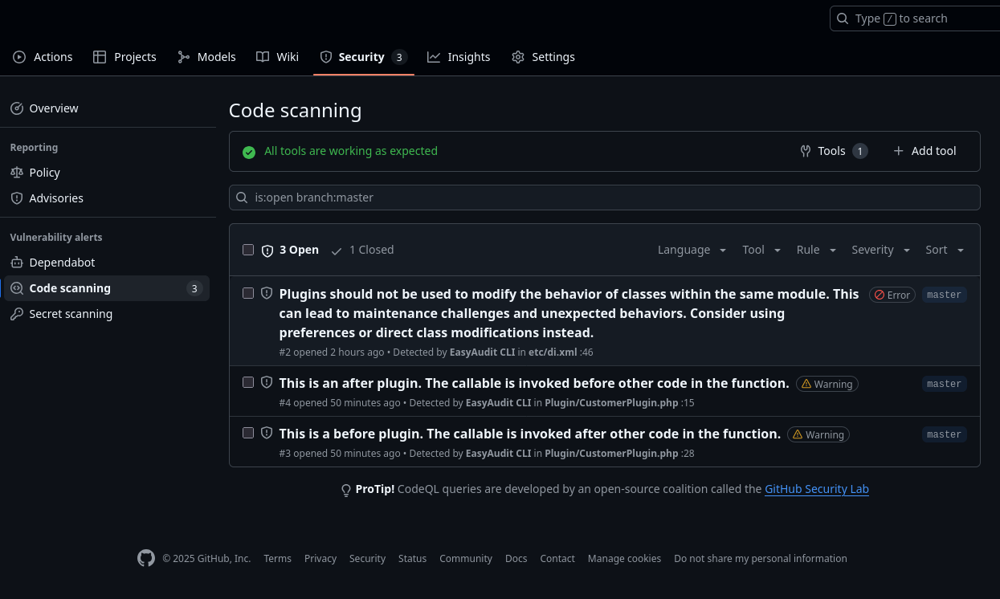

# EasyAudit

[](https://github.com/crealoz/easyaudit-cli/releases)
[](./LICENSE)
[](https://php.net)
[](https://github.com/crealoz/easyaudit-cli/actions)
[](https://codecov.io/gh/crealoz/easyaudit-cli)

Static analysis tool for Magento 2 codebases. Detects anti-patterns, security risks, and architectural issues.

## Features

- **21 processors** detecting **40 anti-patterns** across DI, code quality, templates, performance, and architecture
- **Zero dependencies** - standalone PHAR (~455KB)
- **CI/CD ready** - SARIF output for GitHub Code Scanning
- **Docker image** available
- **Privacy first** - No data sent to external servers ([security details](docs/security.md))


## Quick Start

### Using PHAR
```bash
# Download latest PHAR
curl -LO https://github.com/crealoz/easyaudit-cli/releases/latest/download/easyaudit.phar
chmod +x easyaudit.phar

# Run
php easyaudit.phar scan /path/to/magento --format=sarif
```

### Using Composer
```bash
composer require --dev crealoz/easyaudit-cli
vendor/bin/easyaudit scan /path/to/magento --format=sarif
```

### Using Docker
```bash
docker run --rm --user "$(id -u):$(id -g)" -v $PWD:/workspace ghcr.io/crealoz/easyaudit:latest scan /workspace
```

### From Source
```bash
git clone git@github.com:crealoz/easyaudit-cli.git
php bin/easyaudit scan /path/to/magento
```

## Output Formats

| Format  | Use Case                                  |
|---------|-------------------------------------------|
| `sarif` | GitHub Code Scanning, tooling (default)   |

Console output is always displayed during scan.

Automatic fixing (`fix-apply`) and the HTML, Markdown and JSON reports are part of the [sponsors edition](https://github.com/sponsors/crealoz).

## GitHub Actions

### Scan & upload to Code Scanning

```yaml
name: EasyAudit Scan

on: [push, pull_request]

permissions:
  contents: read
  security-events: write

jobs:
  scan:
    runs-on: ubuntu-latest
    container:
      image: ghcr.io/crealoz/easyaudit:latest
    steps:
      - uses: actions/checkout@v6
      - run: |
          mkdir -p report
          easyaudit scan --format=sarif --output=report/easyaudit.sarif "$GITHUB_WORKSPACE"
      - uses: github/codeql-action/upload-sarif@v4
        with:
          sarif_file: report/easyaudit.sarif
```

> **Private repos**: SARIF upload requires [GitHub Advanced Security](https://docs.github.com/en/get-started/learning-about-github/about-github-advanced-security), which is a paid feature for private repositories. Upload the SARIF file with `upload-artifact` instead. See [GitHub Actions docs](docs/ci-cd/github-actions.md#private-repositories) for alternative workflows.



## Documentation

- [Security & Privacy](docs/security.md) - What data stays local
- [CLI Usage](docs/cli-usage.md) - Commands, options, examples
- [Available Processors](docs/processors.md) - All 21 processors (40 rules)
- [CI/CD Integration](docs/ci-cd.md) - GitHub, GitLab, Bitbucket, Azure, CircleCI, Jenkins, Travis
- Developer Guide: [Writing Processors](docs/developer-guide/processors.md) | [Utilities Reference](docs/developer-guide/utilities.md) | [Extension Points](docs/developer-guide/extension-points.md)

## Requirements

- PHP 8.1+
- Docker (optional)

## License

MIT

