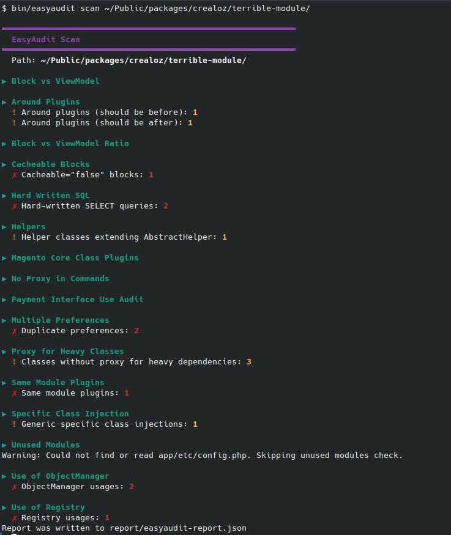

# CLI Usage

## Table of Contents

- [Installation](#installation)
- [Commands](#commands)
- [Common Use Cases](#common-use-cases)
- [Docker Usage](#docker-usage)
- [Exit Codes](#exit-codes)
- [Output Examples](#output-examples)

---

## Installation

### Using PHAR (recommended)

```bash
# Download latest PHAR
curl -LO https://github.com/crealoz/easyaudit-cli/releases/latest/download/easyaudit.phar
chmod +x easyaudit.phar

# Optional: move to PATH
sudo mv easyaudit.phar /usr/local/bin/easyaudit
```

### Using Composer

EasyAudit CLI is published on Packagist under the MIT licence and can be installed as a project dependency:

```bash
composer require --dev crealoz/easyaudit-cli
vendor/bin/easyaudit scan /path/to/magento
```

When installed via Composer, the entry point uses the Composer-generated autoloader (`vendor/autoload.php`) instead of the hand-rolled PSR-4 loader used by the PHAR build.

### Using Docker
```bash
docker pull ghcr.io/crealoz/easyaudit:latest
```

### From Source
```bash
git clone git@github.com:crealoz/easyaudit-cli.git
cd easyaudit-cli
composer install --no-dev   # optional — enables the Composer autoloader; without it the bundled PSR-4 loader is used
php bin/easyaudit scan /path/to/magento
```

---

## Commands

### Scan

Run static analysis on a Magento codebase.

```bash
# Basic scan (SARIF output, default)
php bin/easyaudit scan /path/to/magento

# Explicit SARIF output (for GitHub Code Scanning)
php bin/easyaudit scan /path/to/magento --format=sarif

# Custom output file
php bin/easyaudit scan /path/to/magento --format=sarif --output=report/scan.sarif

# Exclude directories
php bin/easyaudit scan /path/to/magento --exclude="vendor,generated,var"

# Exclude file extensions
php bin/easyaudit scan /path/to/magento --exclude-ext="js,css"
```

### Options

| Option | Description | Default |
|--------|-------------|---------|
| `--format` | Output format: `sarif` | `sarif` |
| `--output` | Output file path | `report/easyaudit-report.sarif` |
| `--exclude` | Comma-separated directories to exclude | none |
| `--exclude-ext` | Comma-separated file extensions to exclude | none |
| `--project-name` | Explicit project identifier (slug) | none |

Automatic fixing (`fix-apply`) and the HTML, Markdown and JSON reports are part of the [sponsors edition](https://github.com/sponsors/crealoz).

### Help

```bash
php bin/easyaudit scan --help
```

---

## Common Use Cases

### Scan app/code only
```bash
php bin/easyaudit scan /path/to/magento/app/code
```

### Scan a single module
```bash
php bin/easyaudit scan /path/to/magento/app/code/Vendor/Module
```

### Scan a Magento root

When pointing at a Magento installation root, noise directories (`vendor`, `generated`, `var`, `pub`, `setup`, `lib`, `dev`, `phpserver`, `update`) are **automatically excluded**. No `--exclude` needed.

```bash
php bin/easyaudit scan /path/to/magento --format=sarif
```

Detection is based on Magento indicators (`bin/magento`, `nginx.conf.sample`, `app/etc/env.php`, `generated/`, `pub/`). At least 2 must be present.

### Quick check before commit
```bash
php bin/easyaudit scan .
```

---

## Docker Usage

> **Tip**: Use `--user "$(id -u):$(id -g)"` so report files are owned by your user instead of root.

### Basic scan
```bash
docker run --rm --user "$(id -u):$(id -g)" -v $PWD:/workspace ghcr.io/crealoz/easyaudit:latest \
  scan /workspace
```

### Scan a specific subdirectory
```bash
docker run --rm --user "$(id -u):$(id -g)" -v $PWD:/workspace ghcr.io/crealoz/easyaudit:latest \
  scan /workspace/app/code
```

---

## Exit Codes

| Code | Meaning |
|------|---------|
| `0` | No errors or warnings found |
| `1` | Warnings found |
| `2` | Errors found |

Use exit codes in CI to fail builds:

```bash
php bin/easyaudit scan /path/to/magento --format=sarif || exit 1
```

---

## Output Examples



The report is written as a SARIF file (`report/easyaudit-report.sarif` by default).

---

[Back to README](../README.md)
